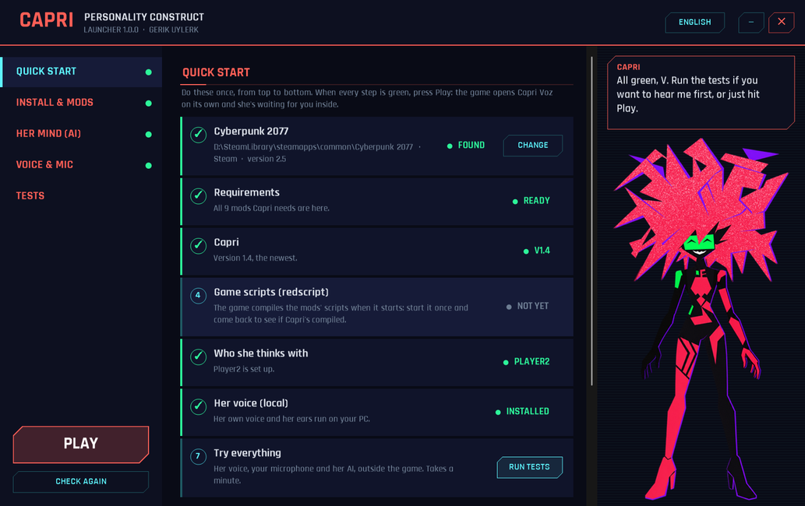
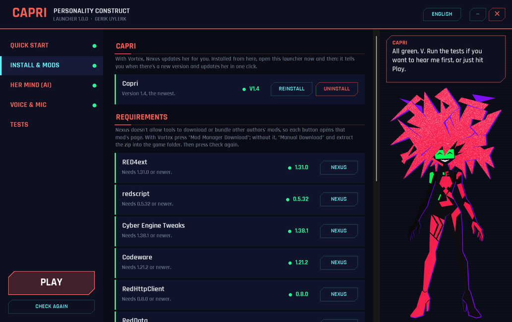
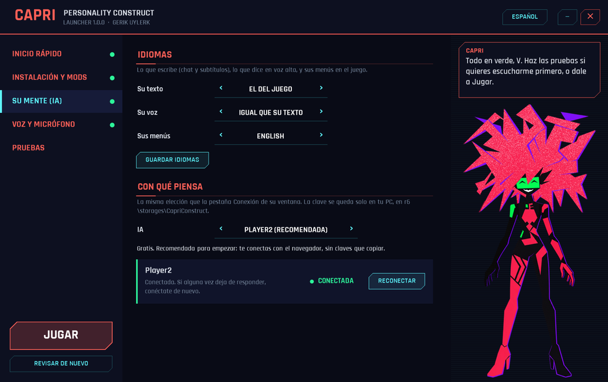
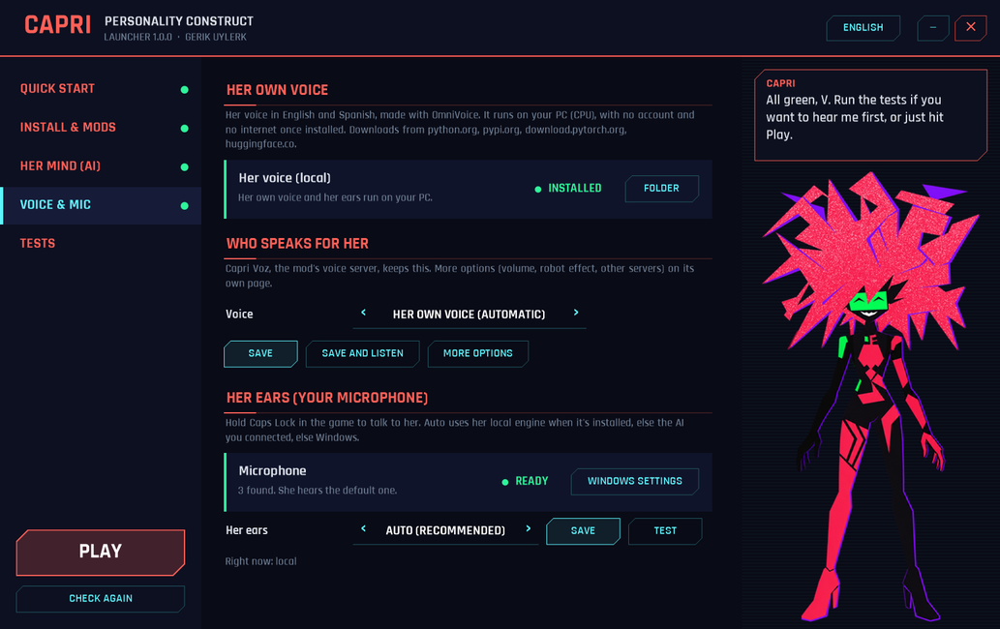

# Capri Launcher

Installer, setup and checkup for **[Capri: Personality Construct](https://www.nexusmods.com/cyberpunk2077/mods/37034)**, the AI companion mod for Cyberpunk 2077.

Open it, follow the green steps, press **Play**. You never run a script, edit a JSON file or hunt for a log. It's an alternative way to install Capri that guides you step by step, and also a checker for any install, Vortex's included: it finds what's missing, outdated or broken and tells you how to fix it.

**[⬇ Download CapriLauncher.exe](https://github.com/CarlosNahuelcoy/capri-launcher/releases/latest)**

## About Capri

Capri is an AI companion who lives in V's head: a personality construct, many digitized minds fused into one. She thinks with a language model (Player2, Gemini, OpenRouter, OpenAI, a local model...), speaks with her own voice, listens through your microphone, remembers what you've been through and helps you out: overheating enemies, hacking cars and cameras, solving breach protocols. She shows up in the world as a red hologram, and only V can see and hear her. Everything about her is on [her Nexus page](https://www.nexusmods.com/cyberpunk2077/mods/37034).

### Requirements

- Cyberpunk 2077 **2.5**
- [RED4ext](https://www.nexusmods.com/cyberpunk2077/mods/2380), [redscript](https://www.nexusmods.com/cyberpunk2077/mods/1511), [Cyber Engine Tweaks](https://www.nexusmods.com/cyberpunk2077/mods/107), [Codeware](https://www.nexusmods.com/cyberpunk2077/mods/7780)
- [RedHttpClient](https://www.nexusmods.com/cyberpunk2077/mods/14192), [RedData](https://www.nexusmods.com/cyberpunk2077/mods/14139), [RedFileSystem](https://www.nexusmods.com/cyberpunk2077/mods/13378)
- [Mod Settings](https://www.nexusmods.com/cyberpunk2077/mods/4885) (needs [ArchiveXL](https://www.nexusmods.com/cyberpunk2077/mods/4198))

The launcher checks each one and its version, and opens its Nexus page if it's missing.

### Installation

Pick one:

- **With the launcher (guided):** download `CapriLauncher.exe`, run it and follow *Quick start* from top to bottom: requirements, Capri, the AI she thinks with, her voice and a test of everything. Then press **Play**.
- **With Vortex:** press *Mod Manager Download* on [Capri's Files tab](https://www.nexusmods.com/cyberpunk2077/mods/37034?tab=files). You can still open the launcher afterwards to check that every step went right.
- **By hand:** extract Capri's zip into the game folder (the one with `bin`, `r6` and `red4ext`).

The game starts Capri Voz, her voice server, on its own. Her window lives in the Cyber Engine Tweaks overlay (your CET key, which the launcher shows you).

**You don't need the launcher to play.** Once everything is green, start the game as always (Steam, GOG, Epic or Vortex) and Capri starts with it. Open the launcher again only to update her, change her setup, or report a problem.

## What the launcher does

- **Finds the game** in Steam (every library), GOG and Epic, or wherever you point it.
- **Checks every requirement and its version**, plus the game version. Anything missing or too old gets a button to its Nexus page.
- **Installs Capri** your way: with Vortex (it opens Capri's file on Nexus), or straight into the game folder. Installed directly, it tells you when there's a new version and updates her in one click.
- **Sets her up without opening the game**: her languages, who she thinks with, who speaks for her and her ears (microphone). **Player2** is the easiest: press *Connect*, approve Capri in your browser, done.
- **Installs her local voice** (about 900 MB, once) and shows each step.
- **OmniVoice, optional, for strong graphics cards**: her same voice cloned live on an NVIDIA card (6 GB of video memory or more), more natural and expressive. Listen to a sample first; installing it leaves everything ready (her cloned voice, the server, and Capri Voz using it). It's heavy: about 6.5 GB to download, and on cards with little memory she may lag while you play, so the launcher checks your card and tells you.
- **Tests everything outside the game**: she speaks, she hears your microphone, her AI answers.
- **Explains the classic problems**: which mod broke the game's scripts when Capri only says *"load a save"*, which key opens her window, old leftover files, a microphone blocked by Windows, a voice install that failed halfway.
- **Report a problem**: it reads the logs of your last game session (the game's, RED4ext's and its plugins', Cyber Engine Tweaks' and its mods', Capri Voz's, and the game's crash note) and builds a report for the mod's Bugs tab on Nexus. It never includes keys, your Windows user name or e-mails.

| Install & mods | Her mind (in Spanish) | Voice & mic |
|---|---|---|
|  |  |  |

The interface is in English by default. The language button at the top switches it to any of the game's languages (Spanish, French, German, Italian, Polish, Brazilian Portuguese, Czech, Hungarian, Turkish, Russian, Ukrainian, Arabic, Thai, Japanese, Korean, Simplified and Traditional Chinese) and is remembered.

## Good to know

- It needs nothing else: .NET Framework 4.8 comes with Windows 10 and 11.
- The exe isn't code-signed yet, so Windows SmartScreen may say *"Windows protected your PC"*. Click **More info → Run anyway**.
- Your keys stay on your PC, in the same files the mod uses (`r6\storages\CapriConstruct\settings.json` and Capri Voz's `config.json`). The launcher only sends them to the service they belong to, when you test it.
- It never downloads other authors' mods: Nexus doesn't allow it, so it opens each requirement's page and you download it there (with Vortex, or by hand).

What it downloads, only when you press the button:

| What | From | Size |
|---|---|---|
| Capri (direct install) and her optional voices | this page's Releases (the same files as on Nexus) | 24 MB, 7 MB each |
| Her local voice engine | python.org, pypi.org, download.pytorch.org, huggingface.co | about 900 MB |
| OmniVoice (optional) | python.org, pypi.org, download.pytorch.org, huggingface.co | about 6.5 GB |
| `manifest.json` (newest Capri version and requirement minimums) | this page | a few KB |

## Credits

Made by **Gerik Uylerk**. Capri and Cyberpunk 2077 belong to CD PROJEKT RED; this is a non-profit fan project.
The requirements are the work of their authors (psiberx, jac3km4, yamashi and the CET team, WopsS, Jack Humbert, Rayshader); get them from their Nexus pages.
Font: Rajdhani by Indian Type Foundry, under the SIL Open Font License ([THIRD-PARTY-NOTICES.txt](THIRD-PARTY-NOTICES.txt)).
